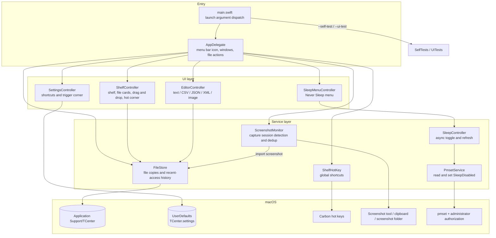

<p align="center">
  
</p>

# AgentAssistant

[中文](README.md) | English

A native macOS menu bar utility: pin temporary text, files and images to the edge of your screen, then edit, preview or drag them into other apps at any time. The same menu also lets you control the system's "Never Sleep" switch.

Built with Swift + AppKit, with no third-party runtime dependencies. The current version is **1.4.0 (build 11)**. The project was formerly named TCenter.

## Features

| Feature | How to use |
| --- | --- |
| File shelf | Click the assistant icon in the menu bar, press the hotkey, or move the pointer into the configured screen corner |
| Quick notes | Press ⌘V on the shelf; text is saved as Markdown automatically. Files and images are supported too |
| Recent file | Open the most recently accessed file in one step; text opens in the editor, images open in the preview |
| File editing | Supports Markdown, TXT, CSV, JSON and XML, with automatic saving after edits |
| Screenshot capture | Detects screenshot actions and only receives new results from the current capture session; the original image is kept |
| Never Sleep | View the system state, turn it on or off, and refresh the state manually |

## Build and install

Requires macOS 13.0 or later and Xcode Command Line Tools with Swift. It is currently verified on Apple Silicon; the build script produces an app for the current machine's architecture, and Intel has not been verified yet.

```sh
git clone https://github.com/jjduys/AgentAssistant.git
cd AgentAssistant

zsh scripts/build.sh
open build/AgentAssistant.app --args --show
```

The GitHub repository, local directory, Swift package and app are all named `AgentAssistant`; the old repository URL `jjduys/TCenter` is redirected automatically by GitHub.

After building, drag `build/AgentAssistant.app` into Applications to install it. It is a menu bar app: once launched, use it through the assistant icon at the top of the screen. It does not show a Dock icon.

To update, quit the running app normally first, then replace the app bundle and open it again. Choose "About AgentAssistant" from the assistant icon's right-click menu to see the version and build number.

The app is ad-hoc signed on the local machine and is not notarized with a Developer ID. Distribution to other machines and behavior on other system versions have not been fully verified.

## Everyday use

### Opening the shelf

| Method | Description |
| --- | --- |
| Hotkey ⌃⌥Space | Show / hide the shelf |
| Hotkey ⌃⌥Return | Open the most recently accessed file |
| Hot corner | Move the pointer into a screen corner (top-left by default) to expand it; it hides 3 seconds after you leave |

Hotkeys and the hot corner can be changed in "Settings…" from the right-click menu (or with ⌘,), and take effect as soon as they are saved. Neither requires Accessibility permission.

### Adding and removing files

- **Add**: click "＋ Add" to create or import a file, press ⌘V to paste files, images or text (text is saved as `.md`), or drag files in from Finder.
- **Use**: click an item to edit or preview it, or drag it out to copy it into another app.
- **Remove**: click an item's ×; the copy is moved to the Trash.

Imported files are always copies; the original files are never touched.

### Editing and autosave

MD, TXT, CSV, JSON and XML can be edited. CSV has a table view and JSON and XML have tree views, each with a toggle back to the source. Images are preview-only.

Edits are saved automatically as UTF-8, and closing an editor window does not remove the file from the shelf.

## Screenshot capture

Just use the macOS screenshot tool as usual. The app identifies a capture session from the screenshot tool launching / activating, changes in its toolbar visibility, and screenshot key events that the system allows it to observe.

- A directory baseline is recorded when the session starts, and only screenshots created afterwards are received; historical images are not scanned or imported at launch.
- Files are copied to the shelf once they are stable, and the original image is kept. Each session ends after successfully receiving one screenshot.
- Both saving screenshots to a file and copying them to the clipboard are supported; clipboard mode does not need access to the screenshot directory.
- The identity and content digest of processed files are persisted to avoid duplicate imports after an item is removed or the app restarts.
- After the screenshot toolbar disappears, the app waits up to 30 seconds for the file to be written, and a session lasts at most 120 seconds; after a timeout or cancellation, it does not scan back for earlier results.

Receiving files depends on access to the system screenshot directory; whether global screenshot keys and Esc events can be observed depends on the permissions the system already grants. If a screenshot action is not detected, expand the shelf and add it manually with ⌘V. Monitoring status is shown in "About AgentAssistant".

The clipboard has no reliable, uniform marker for screenshot origin: while a session is waiting for a clipboard screenshot, copying another image yourself may also be received as that screenshot. While the floating thumbnail is still being edited, file mode can only receive the screenshot after the system actually saves it.

## Never Sleep

Right-click the assistant icon in the menu bar; the top of the menu provides three items:

| Menu item | Meaning |
| --- | --- |
| Never Sleep: On / Off | Shows the current system state; shows "Status unknown" if it cannot be read |
| Turn Off / Turn On Never Sleep | Toggles the system `SleepDisabled` switch |
| Refresh Status | Re-reads the system state immediately |

When toggling, macOS requests administrator authorization; the app never reads or stores the administrator password. The fixed commands it runs are:

```sh
# Turn on
pmset -a disablesleep 1

# Turn off
pmset -a disablesleep 0
```

The command runs with system administrator authorization and the result is read back to confirm it. If authorization is canceled or the command fails, the menu reflects the actual state as re-read from the system. The app also syncs automatically every 5 seconds and after the system wakes, and repeated actions are blocked while a toggle is in progress.

**Quitting the app keeps the current system setting.** To restore it, turn off Never Sleep from the menu first. This feature does not change the display sleep timer, the existing sleep timer, or power assertions from other processes; whether the Mac sleeps automatically after turning it off also depends on your existing system configuration.

## Data and legacy compatibility

AgentAssistant keeps the original TCenter app identifier and storage locations, so existing notes, screenshot history, hotkeys and hot corner settings carry over directly.

| Content | Location |
| --- | --- |
| File copies | `~/Library/Application Support/TCenter/Files/` |
| Recent access records | `~/Library/Application Support/TCenter/Files/.access-history.json` |
| Screenshot processing records | `~/Library/Application Support/TCenter/screenshot-history.json` |
| App settings | `local.tcenter.app` preferences domain, settings key `TCenter.settings` |

Choose "Open Storage Folder" from the right-click menu. To back up, save the app data directories above; to keep your hotkeys and hot corner, also keep the corresponding app preferences.

## Architecture



`AppDelegate` wires everything together: the shelf and editor read and write file copies through `FileStore`; when the screenshot monitor detects a new capture it imports it through `FileStore` and opens the shelf; the Never Sleep menu goes through `SleepController` to `PmsetService`, which tests swap for the in-memory `DemoPowerService`.

## Development and testing

```sh
# Build the app and generate icons in all sizes plus the ICNS file
zsh scripts/build.sh

# Core checks for file formats, storage, access ordering, settings, etc.
build/AgentAssistant.app/Contents/MacOS/AgentAssistant --self-test

# Regression tests for the editors, shelf, menus, icons and interactions
build/AgentAssistant.app/Contents/MacOS/AgentAssistant --ui-test

# Dedicated sleep logic tests
zsh scripts/test-power.sh

# Verify the app bundle
codesign --verify --deep --strict build/AgentAssistant.app
plutil -lint build/AgentAssistant.app/Contents/Info.plist
```

Tests use separate directories and a mock sleep backend, and never change real sleep settings. UI regression tests briefly create test windows, with rendered output in `build/ui-check/`. Build products, test logs and local backups are all kept in the Git-ignored `build/` directory.

Verified so far: core logic, editor and menu regressions, icon generation, the system global hotkey path, and entering, resting in and leaving all four corners on a single screen. Real administrator-authorized toggling, multiple displays / full screen, dragging into external apps, and the full real screenshot flow have not all been accepted on real hardware yet. See [VALIDATION.md](VALIDATION.md) for the detailed scope and history.

### Code structure

```text
Sources/
  App.swift                 Menu bar entry point, file operations and window coordination
  Shelf.swift               Shelf, file cards, drag and drop, and auto-hide
  Editor.swift              Text, Markdown, CSV, JSON, XML and image views
  Models.swift              File storage, recent access records and format codecs
  Settings.swift            Hotkey recording and hot corner settings
  ShelfHotKey.swift         System global hotkey registration
  ScreenshotMonitor.swift   Screenshot session detection, capture and persistent dedup
  PowerService.swift        System sleep state and administrator commands
  SleepController.swift     Async toggling, state refresh and error handling
  SleepMenu.swift           Never Sleep menu
  BrandIcon.swift           Native vector drawing of the app and menu bar icons
  SelfTests.swift           Core checks
  UITests.swift             UI and scenario regressions
Tests/PowerTests.swift      Dedicated sleep logic tests
Tools/GenerateIcons.swift   Icon asset generation
scripts/build.sh            Build and app packaging
scripts/test-power.sh       Compile and run the sleep tests
```

Note: VALIDATION.md is currently available in Chinese only.
